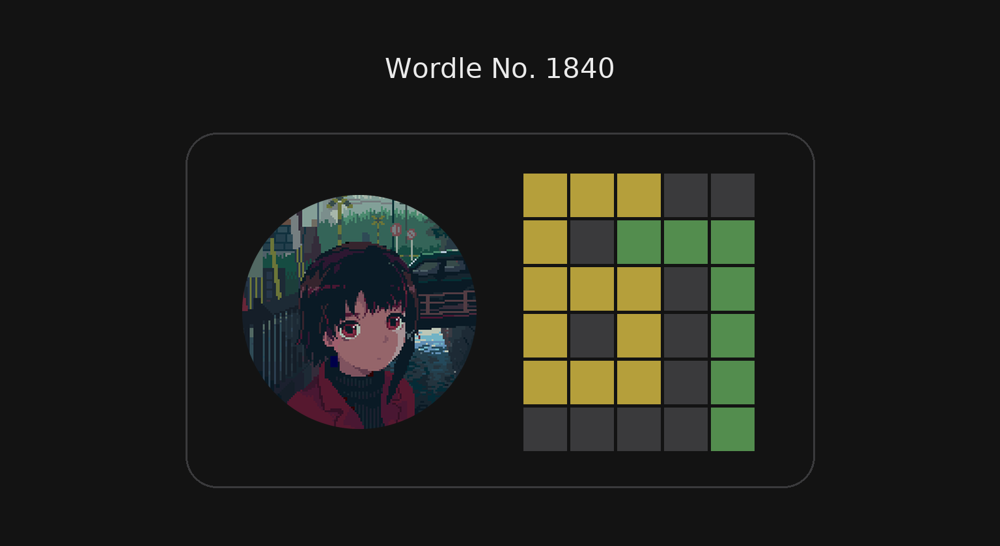

# wordle67

Give it a Wordle answer and it finds 6 guesses that draw **67** on the grid.

## Usage

```bash
python3 wordle67.py -w <word> [options]
```

| Flag | Description |
|------|-------------|
| `-w`, `--word` | The answer / target word (required) |
| `-c6`, `--c6` | Colour of the 6 |
| `-c7`, `--c7` | Colour of the 7 |
| `-bg`, `--bg` | Colour of the background |
| `-l`, `--list` | Word list file (default: `words.txt`) |

Colours: `green`/`g`, `yellow`/`y`, `grey`/`gray`/`b`. The 6, the 7 and the background each need a different colour.

If you don't set a colour, the script tries every possible combination and shows each one that works.

### Examples

```bash
python3 wordle67.py -w crane
python3 wordle67.py -w crane -c6 yellow -c7 green -bg grey
```

## Word list

`words.txt` (included) is the list of valid guesses from [tabatkins/wordle-list](https://github.com/tabatkins/wordle-list).

## Discord bot

`wordle67_bot.py` runs every day at 2am Paris time and posts the grids to a Discord channel when a 67 is possible. Every Sunday it posts a health check, so no Sunday message means the bot is down. It gets the answer from the NYT's free Wordle API and doesn't need sudo.

**Install** (Python 3.9+, no packages needed):

```bash
git clone <repo-url> ~/wordle67
echo 'export DISCORD_WEBHOOK_URL=<your-webhook-url>' > ~/.wordle67.env
chmod 600 ~/.wordle67.env
```

To get the webhook URL: Discord channel → Edit Channel → Integrations → Webhooks → New Webhook.

**Test:**

```bash
cd ~/wordle67
python3 wordle67_bot.py --dry-run --word baton                 # print only
. ~/.wordle67.env && python3 wordle67_bot.py --word baton      # send to Discord
. ~/.wordle67.env && python3 wordle67_bot.py --heartbeat       # test API + weekly check
rm -f state.json                                               # reset after the heartbeat test
```

**Schedule** (cron calls it hourly and the bot only runs once a day, at 2am Paris time):

```bash
(crontab -l 2>/dev/null; echo '0 * * * * . $HOME/.wordle67.env && cd $HOME/wordle67 && python3 wordle67_bot.py --daily-at 2 >> bot.log 2>&1') | crontab -
```

Logs are in `bot.log`, and the run history is in `state.json`.

| Option | Description |
|---|---|
| `--dry-run` | Print messages instead of sending them |
| `--word <word>` | Test with this answer instead of the API (not saved) |
| `--date YYYY-MM-DD` | Use the answer for another day |
| `--heartbeat` | Send the weekly check now |
| `--daily-at <hour>` | Run once a day, at or after this hour (Paris time) |

## Credits

The idea came from a Twitter post, which led me to [this Reddit post](https://www.reddit.com/r/wordle/comments/1uxk3hi/67/).

Made with [Claude](https://claude.ai).
